# ScanGo Frontend Architecture

Maintained in this independent Git repository at **docs/architecture.md**. Updated **2026-11-09**. The guide covers the implemented stack, interfaces, data model, operational limits, and release requirements.

## Contents

1. [Scope, users, and repository boundary](#1-scope-users-and-repository-boundary)
2. [Context, containers, and trust boundaries](#2-context-containers-and-trust-boundaries)
3. [Source ownership and module map](#3-source-ownership-and-module-map)
4. [Screens, navigation, and lifecycle](#4-screens-navigation-and-lifecycle)
5. [Primary workflows and recovery](#5-primary-workflows-and-recovery)
6. [Domain, persistence, and data ownership](#6-domain-persistence-and-data-ownership)
7. [API and internal contracts](#7-api-and-internal-contracts)
8. [Security, privacy, and egress](#8-security-privacy-and-egress)
9. [Design, accessibility, and platform adapters](#9-design-accessibility-and-platform-adapters)
10. [Build, checks, and deployment](#10-build-checks-and-deployment)
11. [Architecture decisions and tradeoffs](#11-architecture-decisions-and-tradeoffs)
12. [Requirements traceability](#12-requirements-traceability)
13. [Dated verification and limitations](#13-dated-verification-and-limitations)
14. [Extension rules and companion repository](#14-extension-rules-and-companion-repository)

## 1. Scope, users, and repository boundary

A self-checkout kiosk simulator for the fictional QuickStop Market.

Barcode/search entry, basket changes, coupons, simulated scale/tender checks, API-issued receipts, print, and reset.

This repository owns the React/Vite web interface, public content, interaction state, and API adapter. The API owns authoritative domain records and permission decisions.

There are two independent Git roots for this application, each with its own README and architecture guide. A parent app/workspace folder is a checkout convenience. Use synthetic records; current local services remain on loopback.

The current implementation boundary is defined by the source map and contracts in this guide.

## 2. Context, containers, and trust boundaries

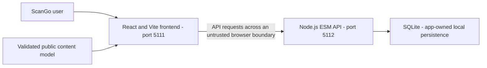

The browser must not grant roles or confirm prices, balances, payments, stock, or workflow completion based only on local state.

### C4 system context

The shopper is an anonymous local user whose checkout is bound to this kiosk by a bearer token held only in module memory ([src/lib/credentials.ts](../src/lib/credentials.ts)). Attendants sign in at the separate `/staff` console ([src/staff](../src/staff)) with a synthetic staff code and PIN; the staff token is also memory-only.

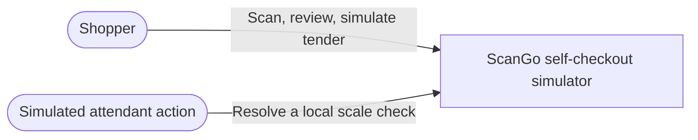

ScanGo has no bank, payment processor, identity provider, inventory service, or external retail integration. It never accepts PAN, CVV, bank credentials, or real payment tokens.

### C4 container view

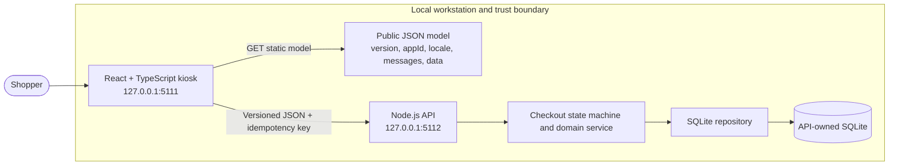

The frontend fetches `public/scango-model.json` with `cache: "no-store"`. Both runtimes validate the supported version-1 `version/appId/locale/messages/data` contract. The model contains user-facing copy, synthetic product/coupon fixtures, presentation settings, and bounded domain limits. API origins and CORS policy are deliberately excluded: Vite build-time variables select an API, and the server owns its `SCANGO_ALLOWED_ORIGINS` allowlist. The API seeds SQLite from the model once; after seeding, its SQLite catalog is authoritative. The frontend sends identifiers, quantity deltas, bounded scale readings, coupon codes, and simulator choices; it never submits a price or total.

## 3. Source ownership and module map

| Owner/path                                                                                                                                                                            | Responsibility                                                     |
| ------------------------------------------------------------------------------------------------------------------------------------------------------------------------------------- | ------------------------------------------------------------------ |
| [src/main.tsx](../src/main.tsx)                                                                                                                                                       | Web entry and composition                                          |
| [src/lib/api.ts](../src/lib/api.ts)                                                                                                                                                   | API transport and response boundary                                |
| [src/config.ts](../src/config.ts)                                                                                                                                                     | Build-time API mode selection and kiosk ID (`VITE_SCANGO_KIOSK_ID`) |
| [src/lib/credentials.ts](../src/lib/credentials.ts)                                                                                                                                   | In-memory shopper and staff tokens; never persisted                |
| [src/lib/staff-api.ts](../src/lib/staff-api.ts) [src/staff/useStaff.ts](../src/staff/useStaff.ts)                                                                                   | Staff transport and console state (polling, conflicts, sign-out)   |
| [src/lib/model-schema.ts](../src/lib/model-schema.ts)                                                                                                                                 | Strict content-model validator (mirrors the backend)               |
| [src/lib/useIdleSession.ts](../src/lib/useIdleSession.ts) [src/components/IdleWarning.tsx](../src/components/IdleWarning.tsx)                                                       | Monotonic idle countdown and the extend/start-over alert dialog    |
| [src/lib/schemas.ts](../src/lib/schemas.ts)                                                                                                                                           | Runtime boundary validation                                        |
| [src/App.tsx](../src/App.tsx) [src/components/KioskWorkspace.tsx](../src/components/KioskWorkspace.tsx) [src/components/WelcomeScreen.tsx](../src/components/WelcomeScreen.tsx) | Screens, composition, and interaction owners; see screen inventory |
| [src/lib/api.ts](../src/lib/api.ts) [src/lib/format.ts](../src/lib/format.ts) [src/lib/schemas.ts](../src/lib/schemas.ts)                                                       | Client hooks, presentation state, and domain adapters              |
| [src/App.css](../src/App.css) [src/index.css](../src/index.css)                                                                                                                    | Authored styling and adaptation rules                              |
| [public/scango-model.json](../public/scango-model.json)                                                                                                                               | Active public content/locale contract; no private credentials      |
| [e2e](../e2e)                                                                                                                                                                         | Existing test/support directory; configured does not mean rerun    |
| [src/test](../src/test)                                                                                                                                                               | Existing test/support directory; configured does not mean rerun    |
| [src/App.test.tsx](../src/App.test.tsx) [src/components/operations.test.tsx](../src/components/operations.test.tsx)                                                                | Examples of existing colocated tests                               |

The source map follows the existing framework directories and test placement.

## 4. Screens, navigation, and lifecycle

UI entry and interaction owners:

- [src/App.tsx](../src/App.tsx)
- [src/components/BasketPanel.tsx](../src/components/BasketPanel.tsx)
- [src/components/CatalogPanel.tsx](../src/components/CatalogPanel.tsx)
- [src/components/KioskWorkspace.tsx](../src/components/KioskWorkspace.tsx)
- [src/components/PaymentPanel.tsx](../src/components/PaymentPanel.tsx)
- [src/components/ReceiptPanel.tsx](../src/components/ReceiptPanel.tsx)
- [src/components/ScaleCheckPanel.tsx](../src/components/ScaleCheckPanel.tsx)
- [src/components/WelcomeScreen.tsx](../src/components/WelcomeScreen.tsx)
- [src/staff/StaffApp.tsx](../src/staff/StaffApp.tsx) and [src/staff/StaffConsole.tsx](../src/staff/StaffConsole.tsx): the attendant console at `/staff`, chosen in [src/main.tsx](../src/main.tsx) by path and never linked from the kiosk. Sign-in form (staff code, PIN as a password field), then the store's exceptions with a required reason select and Approve weight / Remove item buttons. Success and conflict messages use `role=status` and `role=alert`; the list refreshes every 3 seconds while visible. Layout is a single column at 320 px.
- [src/components/IdleWarning.tsx](../src/components/IdleWarning.tsx): an `alertdialog` shown over any open checkout 30 seconds before the server-issued idle window ends. Focus starts on **Keep my checkout**, Tab stays inside the two choices, and the remaining seconds are announced at ten-second marks. The countdown runs on `performance.now()`, so a wrong kiosk clock cannot end or freeze a checkout. At zero the visible checkout clears and the welcome screen explains why.

The active model is [public/scango-model.json](../public/scango-model.json). Preserve existing loading, empty, validation, permission, success, and failure states; model text does not provide server identity. This is a web SPA; the current source owns view/tab selection and component lifecycle. The Vercel rewrite is hosting configuration, not an additional UI router. Follow the authored source for request cancellation, retry, focus cleanup, and local preference behavior; do not infer an offline queue where none exists.

## 5. Primary workflows and recovery

### Narrated user flows

The scenarios below use a local shopper persona. The attendant is a simulated action with no identity check. Preconditions, outcomes, recovery, authorization boundary, and safe telemetry are explicit.

#### 1. Start a shopper session

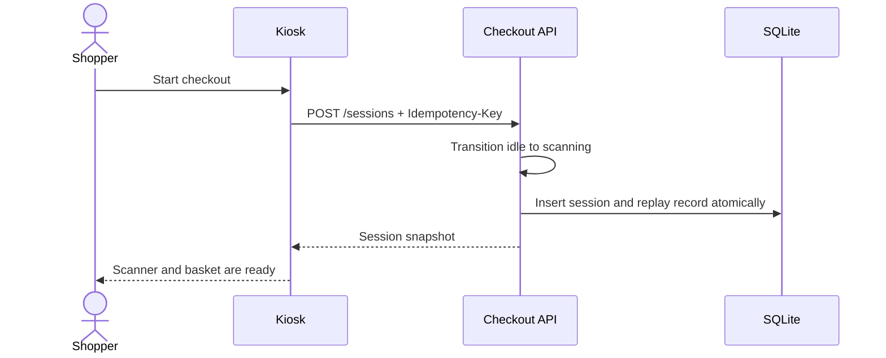

**Precondition:** UI and API are available. **Success:** a persisted scanning session appears. **Failure/recovery:** a safe alert offers retry; the key prevents duplicate session creation on replay. **Authorization/logs:** no authenticated shopper exists; route, request ID, status, and duration are logged without session contents.

#### 2. Search or scan a product

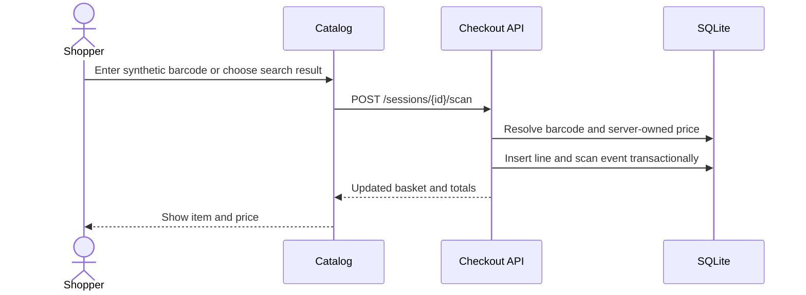

**Precondition:** session is in `scanning`. **Success:** API resolves a known product and adds one unit. **Failure/recovery:** unknown code returns a safe 404; correct the code or use catalog search. **Authorization/logs:** no caller role is trusted; only route/error metadata is logged.

#### 3. Edit basket quantity

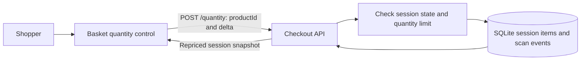

**Precondition:** active scanning session with an item. **Success:** the API applies a bounded delta, removes zero-quantity lines, and returns server totals. **Failure/recovery:** invalid state or quantity returns an error; review the basket and retry. Weighted items require another scale check after quantity changes.

#### 4. Apply or remove a coupon

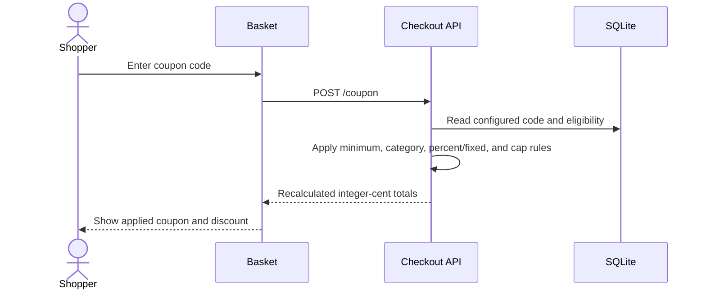

**Precondition:** session is scanning. **Success:** an eligible coupon is recorded and recalculated. **Failure/recovery:** invalid/ineligible codes do not change totals; edit or clear the code. **Authorization/logs:** all rules are server-side; code text is excluded from logs.

#### 5. Check a simulated scale reading

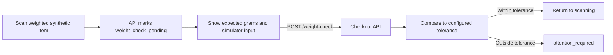

**Precondition:** scan of a weighted item. **Success:** an in-range simulated reading returns to scanning. **Failure/recovery:** mismatch blocks checkout and displays a team-member check. Only bounded integer grams are accepted; logs omit the reading.

#### 6. Resolve an attendant intervention

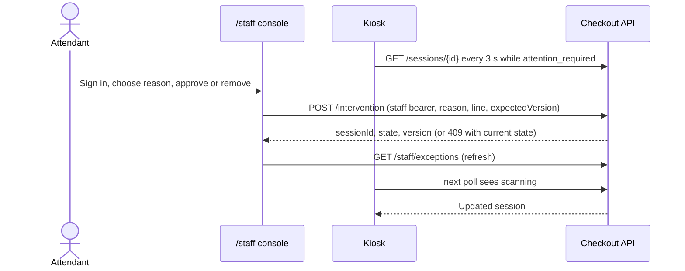

**Precondition:** a scale mismatch is in `attention_required`; the kiosk shows the waiting state with no approve controls. **Success:** the attendant's decision moves the kiosk back to scanning on its next poll. **Failure/recovery:** a decision on a stale version or by a second attendant gets the conflict message and a refreshed list; a wrong PIN or throttled sign-in shows model copy and clears the PIN field; a failed kiosk poll keeps the last confirmed basket, while an expired or vanished session returns to the welcome screen. **Authorization:** a staff token at the session's store is required; shopper tokens are refused.

#### 7. Review checkout totals

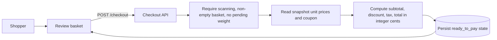

**Precondition:** non-empty basket and all scale checks resolved. **Success:** server returns `ready_to_pay` with exact integer-cent totals. **Failure/recovery:** pending check or empty basket is rejected without advancing state. The browser never supplies price or total values.

#### 8. Simulate tender and retry

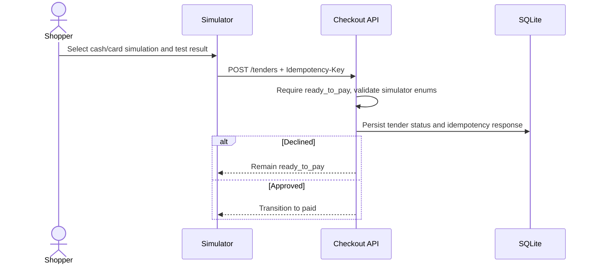

**Precondition:** checkout is ready. **Success:** an approved test outcome enters `paid`; declined remains payable for retry. **Failure/recovery:** repeat with a new key to make another simulated attempt; replaying the old key does not repeat it. No external processor is called and no payment instrument is collected.

#### 9. Issue a receipt

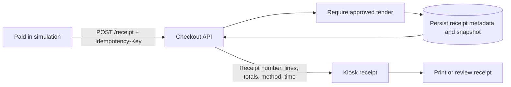

**Precondition:** approved simulated tender. **Success:** one receipt snapshot is stored per session and the session becomes `receipt_issued`. **Failure/recovery:** a missing/declined tender cannot create a receipt; retry after a valid approval. Receipt replay returns the same metadata.

#### 10. Reset the kiosk

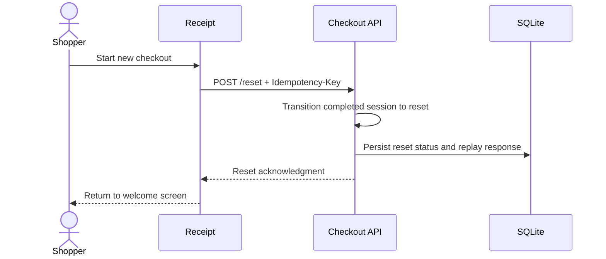

**Precondition:** a persisted session exists. **Success:** the prior session, scans, tender, intervention, and receipt remain recorded while the UI returns to idle. **Failure/recovery:** retrying the same key is safe; a new session receives a new ID. Logs remain metadata-only.

## 6. Domain, persistence, and data ownership

The frontend consumes server-owned domain records; its model supplies presentation and synthetic display content. Local UI state cannot replace backend transaction or authorization decisions.

### Data ownership

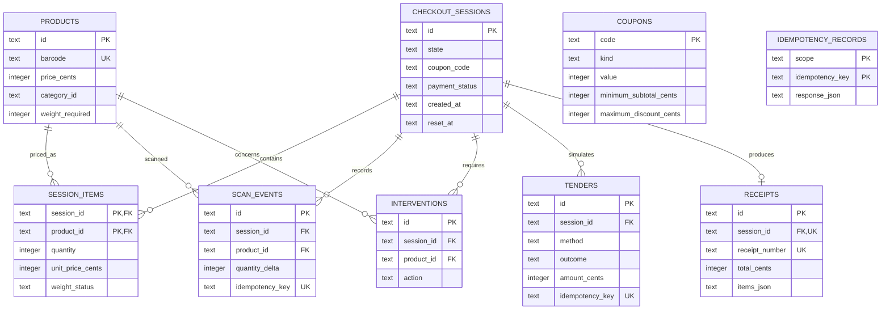

The repository owns schema creation, parameterized statements, seed insertion, explicit transactions, and idempotency replay. Session items snapshot server-owned unit prices. The API stores only synthetic product/checkout data and receipt metadata. SQLite lives at `scango-backend/data/scango.sqlite` by default; `SCANGO_DB_PATH=:memory:` is used in tests.

## 7. API and internal contracts

The companion API contract is in [scango-backend](https://github.com/gopichand-retail-apps/scango-backend). It remains the authority for request/response shapes; the local typed/validated adapter is in the source map. Keep public paths, status/error envelopes, headers, payload validation, and compatibility tied to that source.

### State machine and API contract

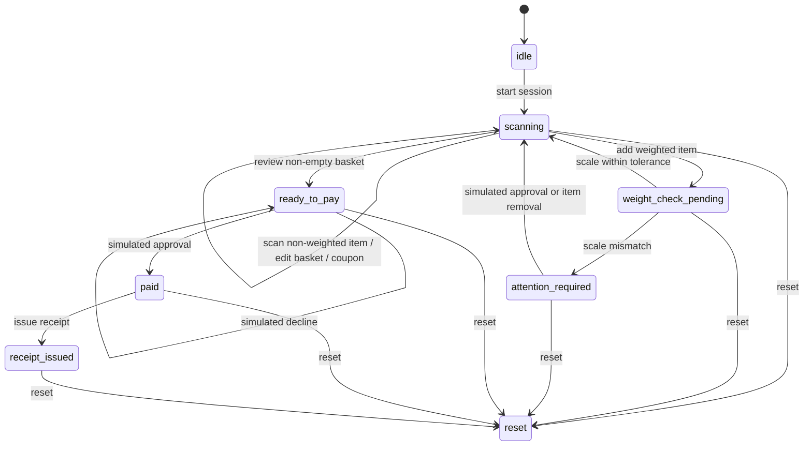

The [OpenAPI document](https://github.com/gopichand-retail-apps/scango-backend/blob/main/openapi.yaml) specifies version `v1`. It exposes health/version/catalog reads, session reads, and idempotent state-changing session actions. Success uses `{ "data": ... }`; errors use `{ "error": { "code", "message", "requestId" } }`. Request size, barcode length, scan-batch count, quantity, scale range, coupon code, and tender enum are server-validated. Coupons, subtotal, discount, tax, and total use integer cents and the API's model/database values.

### API and authorization matrix

| Route group                                                                          | Current caller                | Authentication | Ownership / role check                                               |
| ------------------------------------------------------------------------------------ | ----------------------------- | -------------- | -------------------------------------------------------------------- |
| `GET /health`, `/version`, `/catalog`                                                | Any local caller              | None           | Not applicable; catalog is synthetic                                 |
| `POST /sessions`                                                                     | A registered kiosk            | `X-Kiosk-Id`   | Creates a session bound to that kiosk; returns the bearer token once |
| `GET /sessions/{sessionId}` and `GET /receipt`                                       | The owning kiosk              | Bearer token   | Token digest and kiosk must match; otherwise the same 404 as unknown |
| Session scan, quantity, coupon, weight, checkout, tender, receipt, reset and extend  | The owning kiosk              | Bearer token   | Checked before body parsing or idempotent replay; 410 once idle      |
| `POST /staff/sessions`                                                               | Any local caller              | Code + PIN     | Uniform 401; 5 failures per code per minute then 429; audited        |
| `GET /staff/exceptions`, `POST /staff/sign-out`                                      | Signed-in attendant           | Staff bearer   | Location-scoped; line and version only; 15-minute idle token         |
| `POST /intervention`                                                                 | Signed-in attendant           | Staff bearer   | Same store, current version, matching line; one decision per version |

The API binds to loopback by default. UUIDs and CORS are not authorization. A
session can only be read or changed with its kiosk's token; sessions expire after
180 idle seconds. Exceptions need a staff token at the session's store. The
synthetic PIN identities are a loopback-demo boundary, which remains a deployment blocker.

The tender outcome is deliberately a local user-selectable simulator result. It cannot authorize or move money. A declined attempt is recorded and leaves the session payable; the same idempotency key replays the original response. Receipt issuance requires an approved simulated tender.

## 8. Security, privacy, and egress

Current release limitation: **Shopper sessions are bound to this kiosk by an in-memory bearer token with an idle warning and expiry (SCN-01). Only an attendant signed in at the same store can clear an exception, from the separate `/staff` console (SCN-02); attendant identities are synthetic fixture profiles with PINs. Two Windows backend tests and critical server coverage fail in the baseline; receipt-only print CSS is absent. Separate IT fixes do not change this baseline.**

Only the local simulator controls in the current source are implemented. CORS, a role label, and mode selection do not provide a new production identity boundary.

Keep private credentials out of public models, browser bundles, logs, URLs, and source archives. No additional runtime network destination or external service is configured. Keep logs limited to the source-defined request/trace and safe aggregate fields. Backups, retention, deletion, and real-user ownership need explicit product/operations decisions before external exposure.

## 9. Design, accessibility, and platform adapters

The existing product styling is authored in [src/App.css](../src/App.css), [src/index.css](../src/index.css), [src/styles/kiosk-controls.css](../src/styles/kiosk-controls.css), [src/styles/kiosk-layout.css](../src/styles/kiosk-layout.css). Preserve its tokens, layout density, fonts/assets, breakpoints, and component states. User-facing strings/locale rules follow the active validated model. WCAG 2.2 AA is a target, not a verified conformance claim: keyboard/focus/dialog behavior, zoom/reflow, contrast, reduced motion, and screen readers require their applicable checks. No redesign or new visual measurements were performed here. Native/mobile packaging and device adapters are **not implemented by this web repository**.

## 10. Build, checks, and deployment

Configured npm scripts, from this repository with Node **24.15.0**; use `npm.cmd` in PowerShell:

| Command                     | Actual manifest definition                                                                             |
| --------------------------- | ------------------------------------------------------------------------------------------------------ |
| `npm.cmd run dev`           | `vite --host 127.0.0.1 --port 5111 --strictPort`                                                       |
| `npm.cmd run build`         | `tsc -b && vite build`                                                                                 |
| `npm.cmd run lint`          | `eslint . --max-warnings=0`                                                                            |
| `npm.cmd run format:check`  | `prettier --check --no-error-on-unmatched-pattern "src/**/*.{ts,tsx,css}" "e2e/**/*.ts" "*.ts" "*.js"` |
| `npm.cmd run preview`       | `vite preview --host 127.0.0.1 --port 5111 --strictPort`                                               |
| `npm.cmd run test:unit`     | `vitest run`                                                                                           |
| `npm.cmd run test:coverage` | `vitest run --coverage`                                                                                |
| `npm.cmd run test:e2e`      | `node scripts/test-e2e.mjs`                                                                            |

Install with `npm.cmd ci` and retain [package-lock.json](../package-lock.json). Registry access is required for a clean dependency installation. These commands describe the configured checks; execution results are listed in section 13.

Frontend address: http://127.0.0.1:5111. API health: http://127.0.0.1:5112/api/v1/health. Vercel uses [vercel.json](../vercel.json) and the documented keys in [.env.vercel.example](../.env.vercel.example). The static output is dist; SPA fallback excludes API/socket paths. The environment example is not automatically loaded under that filename. Public endpoints and mode selectors are build inputs; rebuild/redeploy after changes. A hosted frontend still requires an independently verified API.

CI configuration is listed in section 3. Run the configured checks before merging or releasing. Deployment requires separate verification of the selected hosting environment.

## 11. Architecture decisions and tradeoffs

Preserve the existing React/Vite SPA design and SQLite backend boundary. The local implementation minimizes setup; it does not demonstrate hosted persistence or production identity. Do not introduce shared databases, runtime services, framework migrations, or roadmap integrations as incidental documentation work.

The two Git repositories remain separate. Each owns one maintained README and this repository-local architecture guide. Shared application behavior may be described here for contract context, but implementation changes belong to the owning source module.

## 12. Requirements traceability

| Capability                      | Acceptance                                                        | Owner/path                         | Current status                                                | Evidence                               | Risk                                                                                                                                                                                                                        |
| ------------------------------- | ----------------------------------------------------------------- | ---------------------------------- | ------------------------------------------------------------- | -------------------------------------- | --------------------------------------------------------------------------------------------------------------------------------------------------------------------------------------------------------------------------- |
| Repository-local architecture   | Guide available in this checkout and linked from README           | docs/architecture.md; README.md    | Documented and validated                                      | File, link, and diagram checks         | Keep documentation consistent with source changes                                                                                                                                                                           |
| UI composition and API boundary | Preserve existing workflows and failure states                    | src/main.tsx and source map        | Implemented; application verification limits are listed below | Current source and existing app design | Shopper sessions are bound to this kiosk by an in-memory bearer token with an idle warning and expiry (SCN-01). Only an attendant signed in at the same store can clear an exception, from the separate `/staff` console (SCN-02); attendant identities are synthetic fixture profiles with PINs. Two Windows backend tests and critical server coverage fail in the baseline; receipt-only print CSS is absent. Separate IT fixes do not change this baseline. |
| Public deployment               | Verified identity, data durability, recovery, and hosted behavior | Existing deployment/API boundaries | Needs separate hardening/verification                         | No new hosted evidence                 | Local checks do not establish production readiness                                                                                                                                                                          |

## 13. Dated verification and limitations

Last documentation review: **2026-11-09**. The checks below distinguish documentation validation from application and deployment testing.

- Repository-local guide, README link, source-path references, section/contents anchors, and Mermaid syntax: passed documentation validation.
- New application tests/builds, coverage, dependency audits, browser/device accessibility/performance, hosted CI, and Vercel deployment: **not rerun for the documentation updates**.
- Frontend production builds passed on 2026-11-09 with Node 24.15.0. Build success does not establish that all application quality gates pass.
- Outstanding baseline limit: Shopper sessions are bound to this kiosk by an in-memory bearer token with an idle warning and expiry (SCN-01). Only an attendant signed in at the same store can clear an exception, from the separate `/staff` console (SCN-02); attendant identities are synthetic fixture profiles with PINs. Two Windows backend tests and critical server coverage fail in the baseline; receipt-only print CSS is absent. Separate IT fixes do not change this baseline.

The baseline results below record earlier validation. Re-run the listed commands against the current revision before release.

Previously recorded application verification:

### Verification and migration boundary

The repository is the intended adapter boundary for a future PostgreSQL deployment. Automated API tests use in-memory SQLite and ephemeral ports; Playwright builds into an isolated directory and starts an in-memory API. Exact commands and current coverage live in [the validation status](#13-dated-verification-and-limitations). A hosted design must add identity, per-session ownership, attendant/admin authorization, an idle timeout, TLS, managed migrations/backups, kiosk-device controls, retention policy, and independent security review before real data or payment integrations are considered.

## 14. Extension rules and companion repository

Start with [README.md](../README.md) and this guide. The companion repository is [scango-backend](https://github.com/gopichand-retail-apps/scango-backend); clone the pair as siblings when using the existing local integration/model contract. This guide is inside the current repository and does not depend on a parent-folder architecture file to exist.

Update this guide when owned source, routes, persistence, identity, UI states, egress, or deployment behavior changes. Coordinate public contract changes with the companion repository and tests. Preserve existing data, run isolated checks with synthetic records, record failures, and review release and infrastructure changes before publication.
